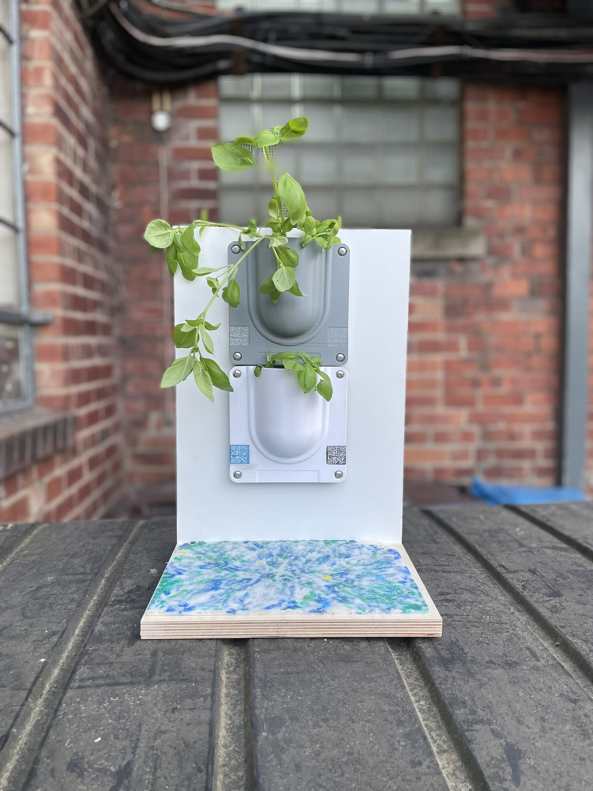

# Community Material Passport

A **Digital Product Passport (DPP)** for community-made, locally-recycled plastic objects — an
open-source template built for the **Design Skills for Embedding Circularity (DSfEC)** design
sprint.

Scan a QR code on a physical object → open this page → scroll its whole material and product
story, understand its impact, and act on it (report wildlife, request a repair, return it to be
remade). The goal is simple: **keep material value inside the community** instead of losing it to
landfill and never seeing it again.

The demo content describes a concept artifact — the *Sharrow Vale community planter wall*, a set
of modular tile planters moulded from neighbourhood HDPE — but everything is placeholder text you
can rewrite for your own scheme.


<!-- ^ this image is a placeholder; drop assets/images/planter-wall.jpg in to see it -->

---

## What's in this folder

```
DSfEC DPP Prototype/
├── index.html               ← flagship passport: Sharrow Vale planter wall (1st life)
├── planter-0143.html         ← worked example: hex planter on its 2nd remake cycle
├── assets/
│   ├── care-and-repair.pdf   ← placeholder downloadable care guide (replace with your own)
│   └── images/               ← drop your photos here (see images/README.txt)
├── README.md                 ← this file
├── LICENSE                   ← MIT
├── .nojekyll                 ← tells GitHub Pages to serve the files as-is
└── .gitignore
```

No build step, no frameworks, no dependencies. Open either `.html` file in any browser and it works.

Two example passports are included so you can see the pattern:

| Page | Object | Story it tells |
| --- | --- | --- |
| `index.html` | Sharrow Vale planter wall | A first-life object made straight from collected household plastic. |
| `planter-0143.html` | Sharrow Vale hex planter | The **same material on its second life** — it was a kitchen caddy before — showing the reuse chain and a lower footprint. |

Give every physical object its own passport by copying one of these files to a new name (e.g.
`planter-0144.html`), editing its content, and pointing that object's QR code at it.

---

## Features

- **Mobile-first**, made for QR-code entry; scales cleanly to desktop.
- **Two themes** — a warm-paper "material receipt" light mode and a dark mode — that follow the
  visitor's device setting automatically, with a manual toggle (remembered between visits).
- **Every section in its own card**: impact stats, the making community, material provenance, the
  manufacturing journey, environmental footprint, wildlife benefits, care & repair, and
  return/remake.
- **Reuse potential** shown as a remake-cycle meter (how many remanufacturing cycles are left).
- **Three actions wired to [Tally](https://tally.so) forms** — log a wildlife sighting, request a
  repair (report broken / return / remould, DIY or not), and find a return point.
- **Care & repair** available two ways: an in-page drop-down *and* a downloadable PDF.
- **Accessible**: semantic HTML, keyboard focus styles, good colour contrast in both themes,
  respects reduced-motion, and `alt` text on every image slot.

---

## Customise it (three easy places)

Everything is inside `index.html`, clearly commented. You do **not** need to know how to code —
you're mostly editing text.

### 1. Content
All the visible words live in the `<body>`. Edit them directly — product name, stats, maker
names, provenance rows, timeline steps, wildlife tags, and so on. Placeholder figures are marked
with a `*` and the caveat "pending verified methodology" — keep or remove that as your data firms
up.

### 2. Images
See [`assets/images/README.txt`](assets/images/README.txt). Drop in `planter-wall.jpg` (and
optionally `pollinators.jpg`) and swap the dashed placeholder box for an `` as shown there.
Replace `assets/care-and-repair.pdf` with your own printable guide.

### 3. Theme colours
Near the top of `index.html`, the `:root` (light) and `:root[data-theme="dark"]` CSS blocks hold
~10 colour values each — background, ink, accent, etc. Change those to rebrand the whole passport.

---

## Wire up the Tally forms

The three action buttons open [Tally](https://tally.so) forms (free to create). Until you add
your links, the buttons show a friendly "not wired up yet" message instead of breaking.

1. Create three forms on Tally:
   - **Wildlife sighting** (what was seen, photo upload, when)
   - **Repair request** — include options for *return* vs *remould* and *do it myself* vs *hand it
     back*
   - **Return / remake** (nearest return point, condition)
2. In each Tally form add a **Hidden field** named exactly `passport` — the passport's batch ID is
   passed in automatically so you know which object a submission is about.
3. Copy each form's share link and paste it into the **`CONFIG`** block near the bottom of
   `index.html`:

   ```js
   var CONFIG = {
     tally: {
       sighting: "https://tally.so/r/XXXXXX",
       repair:   "https://tally.so/r/YYYYYY",
       return:   "https://tally.so/r/ZZZZZZ"
     },
     passportId: "B-0142-A",
     repoUrl: "https://github.com/your-org/community-material-passport"
   };
   ```

That's it — the buttons now open your forms with the object's ID attached.

---

## Publish on GitHub Pages

You have two ways to get these files onto GitHub — pick whichever you're comfortable with.

**Option A — upload in the browser (no command line)**
1. On [github.com](https://github.com), click **New repository**, give it a name (e.g.
   `community-material-passport`), keep it **Public**, and create it.
2. On the new repo's page, click **Add file → Upload files**, then drag in **the contents of this
   folder** (the `.html` files, the `assets/` folder, `README.md`, `LICENSE`, and the hidden
   `.nojekyll` file). Commit.

**Option B — push with Git**
This folder is already a Git repository with an initial commit, so you only need to connect it:
```bash
git remote add origin https://github.com/<your-username>/<repo-name>.git
git branch -M main
git push -u origin main
```

**Then turn Pages on (both options)**
1. In the repo go to **Settings → Pages**.
2. Under **Source** choose **Deploy from a branch**, select your branch (`main`) and the root
   folder (`/`), and **Save**.
3. Wait ~1 minute. Your passports are now live at:
   - `https://<your-username>.github.io/<repo-name>/` → the planter wall (`index.html`)
   - `https://<your-username>.github.io/<repo-name>/planter-0143.html` → the hex planter

> The included `.nojekyll` file makes sure GitHub Pages publishes the files exactly as they are.

## Make a QR code

Point each object's QR code at **its own** passport URL (any free QR generator works — search
"URL to QR code"). Print it on, or beside, the physical object. Because each passport carries its
own `passportId`, you'll always know which object a Tally submission came from.

---

## Fork it for your community

This is meant to be copied. Rename the scheme, swap the colours, rewrite the content, and adapt
the sections to whatever your makerspace produces. If you improve the template, sharing it back
helps every other community doing the same work.

---

## Licence

Code is released under the **MIT Licence** (see [`LICENSE`](LICENSE)) — do what you like with it.
If you reuse the written framework/content, a **Creative Commons Attribution (CC-BY 4.0)** credit
to the DSfEC design sprint is appreciated but not required.
